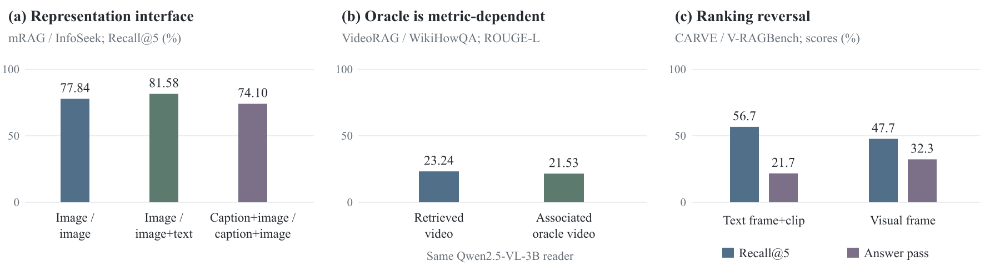

# Figures for the ACL survey revision

Updated 18 October 2026. These figures combine editable vector schematics with image elements from the earlier survey. The schematics illustrate the conceptual framework. The new contrast figure transcribes explicitly identified published results; it is not a new experiment or reproduction. The original 81-paper [DBLP verification](VERIFIED_REFERENCES.md) remains unchanged.

Typography is now Times-compatible Nimbus Roman with embedded font subsets, regular-weight body labels and restrained bold headings. White panels, fine rules and muted slate-blue/plum/ochre/sage accents follow the reference papers' quiet visual hierarchy. Colours are adapted choices, not exact copies. The [style specification](assets/acl-figures/style-spec.json) records the palette and typography. Colour and grayscale previews were inspected.

## Information roles across vision tasks

[Vector PDF](assets/acl-figures/overview.pdf). Concrete image, recognition, synthesis and memory examples distinguish the roles of selected information.

## Published diagnostic contrasts (main-text Figure 2)

[Editable SVG](assets/acl-figures/audited_contrasts.svg) · [Manuscript TikZ](assets/acl-figures/audited_contrasts.tex) · [Conditions and source locators](metadata/synthesis-audit-20261018/published-contrasts.json).

The panels use mRAG Table 3 (InfoSeek, frozen EVA-CLIP), published VideoRAG Table 1 (WikiHowQA, Qwen2.5-VL-3B, visual-only), and CARVE v2 Table 3 (within-video ablation). Metrics retain distinct meanings and protocols. No cross-paper ranking or significance claim is made. Visual-RAG's old model scores are excluded because its annotation release was corrected. The representation-path and 3D schematics are retained in the manuscript appendix.

## Representations, retrieval and reader input

[Vector PDF](assets/acl-figures/representations.pdf). Aligned stages distinguish text conversion, shared visual–text representations and modality-specific indexes.

## Uses of retrieved 3D content

[Vector PDF](assets/acl-figures/structural_references.pdf). Schematic information flow for Phidias and ReDream; illustrative image elements are not comparative outputs.

## Design references and source elements

The stage structure and concrete query examples were informed by [Ask in Any Modality](https://aclanthology.org/2025.findings-acl.861/); the matched-panel comparison by [Scaling Beyond Context](https://aclanthology.org/2026.acl-long.204/); and representation/reader separation by [A Survey on Multimodal RAG](https://arxiv.org/abs/2504.08748). Their artwork was not copied.

The [element provenance](assets/acl-figures/source-elements.json) identifies original survey PDFs, extracted image objects, crops and dimensions. Text, arrows and schematics are vector content; original photos and renders remain raster images. Editable TikZ and the deduplicated image source are maintained alongside the manuscript in Overleaf.
